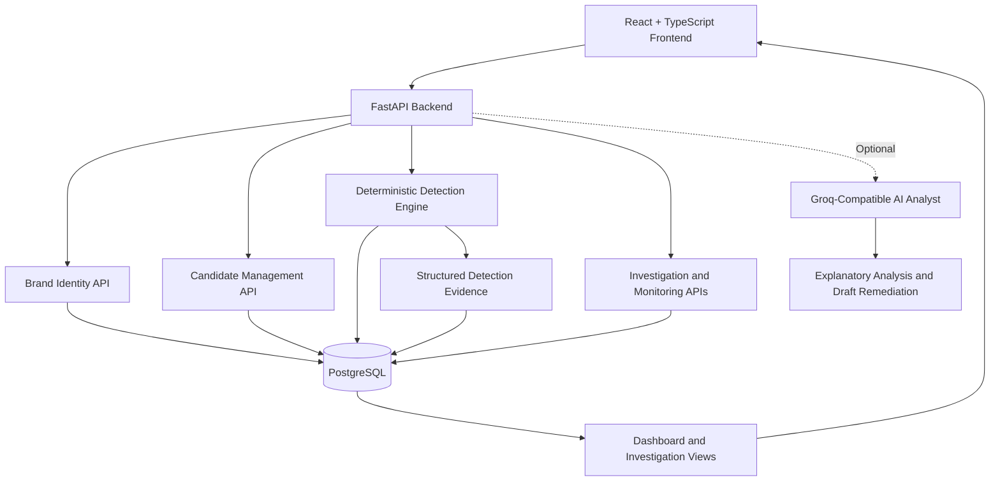
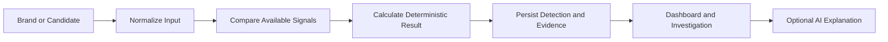

# BrandShield

**Digital Risk Protection — identify look-alike identities, analyze suspicious candidates, preserve detection evidence, and support analyst-led investigations.**

BrandShield is a local-first Digital Risk Protection (DRP) prototype built around deterministic detection, persisted evidence, and transparent investigation workflows. It provides protected brand identity baselines, synthetic social and app-store candidates, structured detection results, investigation workspaces, draft-only remediation, and an optional AI Analyst that explains findings without overriding the detection engine.

The project is designed for controlled demonstrations and competition evaluation. It uses synthetic demo records and does not perform live social-media or app-store scraping.

---

## Quick Links

- [Architecture](#architecture)
- [Features](#features)
- [Tech Stack](#tech-stack)
- [Project Structure](#project-structure)
- [Getting Started](#getting-started)
- [Environment Variables](#environment-variables)
- [API Reference](#api-reference)
- [Testing](#testing)
- [Demo Walkthrough](#demo-walkthrough)
- [Security and Safety](#security-and-safety)
- [Limitations](#limitations)

---

## Architecture

BrandShield uses a three-layer architecture: a React frontend, a FastAPI backend, and PostgreSQL for persistent application data.



### Local services

| Component | Technology | Default address |
|---|---|---|
| Frontend | React, TypeScript, Vite | `http://localhost:5173` |
| Backend | FastAPI, Uvicorn | `http://localhost:8000` |
| Database | PostgreSQL via Docker Compose | `localhost:5432` |
| API documentation | FastAPI Swagger UI | `http://localhost:8000/docs` |

The frontend communicates with the backend through `VITE_API_BASE_URL`. The health endpoint checks database connectivity before reporting a connected state.

### Detection pipeline



The detection engine is authoritative for risk scores, severity, classifications, and structured evidence. The optional AI Analyst explains persisted findings and can draft remediation text; it cannot change detection results or execute remediation actions.

---

## Features

**Protected Brand Identity** — maintain official brand profiles, reference assets, official social accounts, and known applications as the baseline for comparison.

**Synthetic Candidate Monitoring** — manage controlled social-account and app-store candidate records with explicit observation states.

**Deterministic Detection Engine** — analyze names, social handles, and app candidates using available similarity, look-alike, description, and publisher signals.

**Structured Evidence** — persist analysis results and ordered evidence so the dashboard and investigation views display the backend's actual results.

**Risk Classification** — present deterministic risk classifications while avoiding the interpretation of similarity scores as statistical confidence.

**Dashboard and Monitoring** — view persisted detections, brand-level results, monitoring information, and source status.

**Investigation Workflow** — inspect detections, investigate suspicious candidates, maintain investigation status, and review remediation drafts.

**Optional AI Analyst** — use a server-side Groq-compatible API to generate evidence-grounded explanations and draft remediation notes. A deterministic fallback is available when no usable provider is configured.

**Health Monitoring** — expose `GET /api/health` to report API and database connectivity.

**Local Database Inspection** — use DBeaver or another PostgreSQL client to inspect the persisted demo data and detection records.

---

## Tech Stack

| Layer | Technology |
|---|---|
| Language | Python 3.13 |
| Backend API | FastAPI, Uvicorn |
| Database ORM | SQLAlchemy |
| Database | PostgreSQL |
| Schema migrations | Alembic |
| Frontend | React, TypeScript |
| Build tool | Vite |
| Database development environment | Docker Compose |
| AI Analyst | Optional Groq-compatible OpenAI-style API |
| API testing | Postman or HTTP client |
| Database inspection | Optional DBeaver |
| Python dependencies | pip and project-local virtual environment |

---

## Project Structure

```text
BrandShield/
├── backend/
│   ├── alembic.ini
│   ├── alembic/
│   │   └── versions/          # Database migration history
│   ├── app/
│   │   ├── main.py            # FastAPI application
│   │   ├── seed.py            # Synthetic demo-data seeder
│   │   ├── models.py          # Database models
│   │   ├── schemas.py         # Request and response schemas
│   │   ├── analyst.py         # Optional AI Analyst
│   │   ├── sources.py         # Source-status functionality
│   │   ├── api/
│   │   │   ├── brands.py
│   │   │   ├── dashboard.py
│   │   │   ├── detections.py
│   │   │   ├── health.py
│   │   │   ├── investigations.py
│   │   │   ├── monitoring.py
│   │   │   └── sources.py
│   │   ├── core/
│   │   │   └── config.py      # Environment-based configuration
│   │   ├── database/
│   │   │   ├── base.py
│   │   │   └── session.py
│   │   └── detection/
│   │       ├── engine.py
│   │       ├── normalization.py
│   │       └── signals.py
│   └── tests/                 # Backend test suite
├── frontend/
│   ├── src/
│   │   ├── main.tsx
│   │   ├── api.ts             # Typed API client
│   │   ├── AppSidebar.tsx
│   │   ├── BrandLogo.tsx
│   │   ├── BrandProfileEditor.tsx
│   │   ├── CheckName.tsx
│   │   ├── PerimeterVisualization.tsx
│   │   └── SourceStatus.tsx
│   ├── index.html
│   └── vite.config.ts
├── data/                      # Controlled demo-data storage
├── docs/                      # Project documentation
├── scripts/                   # Development and QA helpers
├── docker-compose.yml
├── .env.example
└── README.md
```

---

## Getting Started

### Prerequisites

- Windows with PowerShell, or a compatible development environment
- Node.js 24 LTS and npm
- Python 3.13 available through the Windows Python launcher (`py`)
- Docker Desktop with Docker Compose
- Git

Do not install native PostgreSQL solely for this project. The local database is provided through Docker Compose.

### 1. Clone the repository

```powershell
git clone <YOUR_REPOSITORY_URL>
cd BrandShield
```

Replace `<YOUR_REPOSITORY_URL>` with the Git repository URL.

### 2. Configure environment variables

Copy the example environment file:

```powershell
Copy-Item .env.example .env
```

Edit `.env` and configure a unique local PostgreSQL password. Ensure that the password in `DATABASE_URL` matches the database password configured for Docker Compose.

The `.env` file contains local configuration and should not be committed to Git.

### 3. Create the Python environment

Confirm Python 3.13 is available:

```powershell
py --list
```

Create the repository-local virtual environment:

```powershell
py -3.13 -m venv .venv
```

Activate it:

```powershell
.\.venv\Scripts\Activate.ps1
```

Verify the interpreter and pip locations:

```powershell
python --version
python -m pip --version
```

The Python version should be 3.13.x, and pip should point inside the repository's `.venv`.

### 4. Install backend dependencies

Run from the repository root:

```powershell
python -m pip install -e ".[dev]"
```

If your checkout uses the backend subdirectory as the package root instead, use the dependency installation command supported by `backend/pyproject.toml`.

### 5. Install frontend dependencies

```powershell
npm install --prefix frontend
```

### 6. Start PostgreSQL

```powershell
docker compose up -d postgres
docker compose ps
```

Wait until the PostgreSQL container is healthy before continuing.

### 7. Apply database migrations

Run the migration command from the repository root:

```powershell
.\.venv\Scripts\python.exe -m alembic -c backend\alembic.ini upgrade head
```

If your Alembic configuration is intended to run from `backend`, change into that directory and use the corresponding project-local Python executable instead.

### 8. Seed synthetic demo records

```powershell
.\.venv\Scripts\python.exe -m app.seed
```

Run this from `backend` if the application package is not importable from the repository root. The seeder is designed to be safe to run repeatedly.

### 9. Start the backend

From the `backend` directory:

```powershell
..\.venv\Scripts\python.exe -m uvicorn app.main:app --reload --port 8000
```

The API will be available at `http://localhost:8000`.

### 10. Start the frontend

Open a second terminal at the repository root:

```powershell
npm run dev --prefix frontend
```

Open `http://localhost:5173`.

The frontend should display the actual health-check response from the backend.

### Verify the API

Open the Swagger documentation:

`http://localhost:8000/docs`

Or send a GET request to:

`http://localhost:8000/api/health`

Expected healthy response:

```json
{
  "status": "ok",
  "database": "connected"
}
```

The exact response depends on the backend's health schema. An unreachable database should be reported as a degraded state rather than being represented as connected.

---

## Environment Variables

Configure local values in the repository-root `.env` file.

| Variable | Required | Description |
|---|---|---|
| `POSTGRES_PASSWORD` | Yes for the default local database setup | Password for the PostgreSQL container |
| `POSTGRES_PORT` | No | Host port for PostgreSQL; defaults to `5432` |
| `DATABASE_URL` | Yes | SQLAlchemy-compatible PostgreSQL connection string |
| `CORS_ORIGINS` | No | Comma-separated list of permitted frontend origins; defaults to the local Vite origin |
| `LLM_API_KEY` | No | API key for the optional Groq-compatible AI Analyst |
| `LLM_MODEL` | No | AI model identifier; defaults to `openai/gpt-oss-120b` |
| `LLM_BASE_URL` | No | OpenAI-compatible provider endpoint; defaults to `https://api.groq.com/openai/v1` |
| `LLM_TIMEOUT_SECONDS` | No | Provider request timeout; defaults to `20.0` |

Without a usable AI provider configuration, the backend falls back to deterministic, evidence-grounded explanations. Core detection functionality does not require an AI API key.

**Never commit `.env`, database credentials, or API keys.**

---

## API Reference

The API exposes endpoints for health checks, brand identity management, candidate records, deterministic analysis, persisted detections, monitoring, source status, and investigations.

### Health and brand identity

| Method | Endpoint | Purpose |
|---|---|---|
| `GET` | `/api/health` | Check API and database health |
| `GET` | `/api/brands` | List protected brands |
| `POST` | `/api/brands` | Create a brand |
| `GET` | `/api/brands/{id}` | Retrieve brand details |
| `GET` | `/api/brands/{id}/assets` | Retrieve official brand assets |
| `GET` / `POST` | `/api/brands/{id}/social-accounts` | Read or register official social accounts |
| `GET` / `POST` | `/api/brands/{id}/apps` | Read or register official applications |

### Candidate management

| Method | Endpoint | Purpose |
|---|---|---|
| `GET` / `POST` | `/api/brands/{id}/social-candidates` | Read or register synthetic social candidates |
| `GET` / `POST` | `/api/brands/{id}/app-candidates` | Read or register synthetic app candidates |

Candidate records represent observations. Their workflow states include `NEW`, `REVIEWED`, and `IGNORED`. They do not independently represent a threat score or statistical confidence.

### Detection and analysis

| Method | Endpoint | Purpose |
|---|---|---|
| `POST` | `/api/analyze/name` | Analyze a supplied name |
| `POST` | `/api/analyze/social/{candidate_id}` | Analyze a social candidate |
| `POST` | `/api/analyze/app/{candidate_id}` | Analyze an app candidate |
| `POST` | `/api/detections/scan` | Run a detection scan |
| `GET` | `/api/detections` | List persisted detections |
| `GET` | `/api/detections/{id}` | Retrieve a detection and its evidence |

### Dashboard, monitoring, and sources

| Method | Endpoint | Purpose |
|---|---|---|
| `GET` | `/api/dashboard/overview` | Retrieve dashboard metrics |
| `GET` | `/api/sources/status` | Retrieve source status |
| `GET` | `/api/detections` | Retrieve detection results |

### Investigation workflow

Investigation endpoints support reviewing findings, tracking investigation state, and working with remediation drafts. Consult `/docs` for the exact routes, request schemas, response models, and supported status transitions in the current checkout.

API schemas may evolve as the project develops. The running FastAPI Swagger UI is the authoritative reference for the current implementation.

---

## Demo Walkthrough

Use the dashboard to explore the controlled demonstration:

1. Select **Nike** as the protected brand.
2. Review the persisted official identity baseline on the Brand Profile page.
3. Run a local scan using the available synthetic candidate records.
4. Open **N1ke Shopping**.
5. Inspect the persisted analysis, publisher mismatch, look-alike transformation, and supporting evidence.
6. Open the investigation workspace and inspect its current status.
7. Review the remediation draft and AI Analyst explanation, when available.

All candidates and findings are controlled demo records. They should not be interpreted as reports of actual brand abuse.

---

## Testing

Run backend tests from the `backend` directory using the repository-local interpreter:

```powershell
..\.venv\Scripts\python.exe -m pytest
```

For a faster unit-test run, excluding integration tests:

```powershell
..\.venv\Scripts\python.exe -m pytest -m "not integration"
```

Build the frontend from the repository root:

```powershell
npm run build --prefix frontend
```

The test suite covers areas such as health checks, brand CRUD, deterministic detection, normalization and similarity signals, investigation workflows, and dashboard aggregation, subject to the tests present in the current checkout.

---

## Database Inspection with DBeaver

DBeaver is optional and is not required to run BrandShield.

Create a PostgreSQL connection using:

- **Host:** `localhost`
- **Port:** The value of `POSTGRES_PORT`, normally `5432`
- **Database:** The database configured in `.env`
- **Username:** The configured PostgreSQL user
- **Password:** The value of `POSTGRES_PASSWORD`

Use the connection to inspect protected brands, official identity records, synthetic candidates, persisted detections, and associated evidence.

---

## Security and Safety

- API credentials are supplied through server-side environment variables.
- The browser does not send AI provider credentials to an external model provider.
- The deterministic detection engine remains authoritative for risk scores, severity, classifications, and structured evidence.
- The optional AI Analyst is explanatory and cannot modify stored detection results.
- Remediation output is always **DRAFT ONLY — NOT SENT**.
- Synthetic observations must not be presented as verified real-world threats.
- Similarity scores are signals for investigation, not proof of malicious intent.

---

## Limitations

- Detection operates on controlled, persisted synthetic data.
- Live crawling of social networks, app stores, and domain registries is not implemented.
- External-platform monitoring is not live.
- Remote logo URLs are not treated as successfully analyzed assets when the image cannot be retrieved.
- Similarity scores are not statistical confidence estimates.
- Authentication and automated takedown execution are not implemented.
- Production readiness and a public deployment are not claimed by this local-development README.

---

## Core Principle

> **Similarity alone is not proof of maliciousness.**

BrandShield is designed to support evidence-driven investigation. Automated analysis highlights relevant signals; human review determines what those signals mean and what action, if any, should follow.
